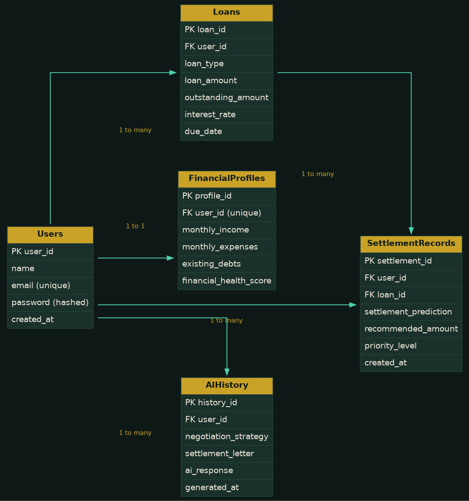

# FinRelief AI

**AI-Powered Debt Relief & Financial Recovery Platform**

FinRelief AI helps users track every loan they carry, understand their
financial health with a transparent, explainable score, predict how likely a
creditor is to accept a settlement, and generate negotiation strategies and
settlement letters using Google's Gemini API.



---

## Tech stack

| Layer      | Technology                                                        |
|------------|--------------------------------------------------------------------|
| Backend    | Python 3.11+, FastAPI, SQLAlchemy, SQLite, JWT (python-jose), Pydantic, passlib (bcrypt) |
| AI         | Google Gemini API (`google-generativeai` REST endpoint), with an offline fallback |
| Frontend   | React 19, Vite, React Router, Axios, Tailwind CSS, Recharts        |
| Packaging  | Docker, docker-compose                                              |

---

## Project structure

```
FinRelief-AI/
├── backend/
│   ├── app/
│   │   ├── api/            # FastAPI routers (auth, loans, profile, settlement, ai, dashboard, users)
│   │   ├── models/         # SQLAlchemy ORM models
│   │   ├── schemas/        # Pydantic request/response schemas
│   │   ├── services/       # Business logic: scoring, settlement prediction, Gemini integration
│   │   ├── auth/           # Password hashing, JWT creation/validation, auth dependency
│   │   ├── utils/          # Logging config, database seed script
│   │   └── database.py     # SQLAlchemy engine/session/Base
│   ├── main.py              # FastAPI app entrypoint
│   ├── requirements.txt
│   ├── .env.example
│   └── Dockerfile
├── frontend/
│   ├── src/
│   │   ├── components/     # Sidebar, Topbar, charts, forms, modal, toast, RecoveryArc, etc.
│   │   ├── pages/          # Landing, Login, Register, Dashboard, Loans, Settlements, AI Assistant, Profile
│   │   ├── services/       # Axios API clients per module
│   │   ├── hooks/          # useAuth, useDarkMode
│   │   ├── App.jsx
│   │   └── main.jsx
│   ├── package.json
│   ├── vite.config.js
│   ├── tailwind.config.js
│   ├── .env.example
│   └── Dockerfile
├── docs/
│   ├── SYSTEM_DESIGN.md              # Complete System Architecture (HLD & LLD)
│   ├── PROJECT_PRESENTATION_GUIDE.md # Viva, Interview & Demo Presentation Guide
│   ├── ER_Diagram.png                # Visual Entity-Relationship Diagram
│   ├── API_DOCUMENTATION.md          # REST API Endpoints Specification
│   └── DATABASE_SCHEMA.md            # Schema Tables & Constraints
├── start_all.bat           # 1-Click launcher for both services (Windows)
├── start_backend.bat       # Backend launcher (Windows)
├── start_frontend.bat      # Frontend launcher (Windows)
├── docker-compose.yml
├── .gitignore
└── README.md
```

---

## Quick Start (Windows 1-Click)

Simply double-click:
```bash
start_all.bat
```
This automatically starts both the FastAPI backend (`http://127.0.0.1:8000`) and the Vite React frontend (`http://127.0.0.1:5173`) in separate dedicated consoles.

**Demo credentials:**
- **Email:** `demo@finrelief.ai`
- **Password:** `Demo@1234`

---

## Getting started (local, without Docker)

### 1. Backend

```bash
cd backend
python3 -m venv venv
source venv/bin/activate        # Windows: venv\Scripts\activate
pip install -r requirements.txt

cp .env.example .env
# Edit .env and set SECRET_KEY and (optionally) GEMINI_API_KEY

# Seed the database with a demo user, loans, and settlement records
python -m app.utils.seed

# Run the API
uvicorn main:app --reload
```

The API is now live at `http://127.0.0.1:8000`, with interactive docs at
`http://127.0.0.1:8000/docs`.

**Demo login:** `demo@finrelief.ai` / `Demo@1234`

### 2. Frontend

```bash
cd frontend
npm install
cp .env.example .env   # defaults to http://127.0.0.1:8000, adjust if needed
npm run dev
```

Visit `http://127.0.0.1:5173`.

---

## Getting started (Docker)

From the project root:

```bash
cp backend/.env.example backend/.env   # optional, compose provides sane defaults
docker compose up --build
```

- Backend: `http://localhost:8000`
- Frontend: `http://localhost:5173`

Set `GEMINI_API_KEY` as an environment variable (or in a root `.env` file)
before running `docker compose up` to enable live Gemini responses; without
it, the AI endpoints use a deterministic offline fallback so the app still
works end-to-end.

---

## Environment variables

### Backend (`backend/.env`)

| Variable                     | Description                                   | Default                          |
|-------------------------------|------------------------------------------------|-----------------------------------|
| `DATABASE_URL`                | SQLAlchemy connection string                   | `sqlite:///./finrelief.db`        |
| `SECRET_KEY`                  | JWT signing secret — **change in production**  | *(placeholder, must be changed)*  |
| `JWT_ALGORITHM`               | JWT signing algorithm                          | `HS256`                           |
| `ACCESS_TOKEN_EXPIRE_MINUTES` | Token lifetime in minutes                      | `60`                               |
| `GEMINI_API_KEY`              | Google Gemini API key                          | *(empty — triggers offline fallback)* |
| `GEMINI_MODEL`                | Gemini model name                              | `gemini-1.5-flash`                |

### Frontend (`frontend/.env`)

| Variable       | Description               | Default                    |
|-----------------|----------------------------|------------------------------|
| `VITE_API_URL`  | Backend base URL           | `http://127.0.0.1:8000`     |

---

## Sample data

Running `python -m app.utils.seed` creates:
- A demo user (`demo@finrelief.ai` / `Demo@1234`)
- A financial profile (income, expenses, existing debts)
- Three loans (Credit Card, Personal Loan, Auto Loan) with realistic balances
- Settlement predictions for each loan
- One sample AI negotiation strategy entry

---

## Features

- **Authentication** — register, login, JWT-protected routes, bcrypt password hashing.
- **Loan module** — full CRUD, scoped per user.
- **Financial profile** — income/expenses/debts input, auto-computed Financial Health Score and Debt-to-Income ratio.
- **Settlement module** — explainable settlement probability, recommended offer amount, and priority level per loan.
- **AI module** — Gemini-powered negotiation strategy, settlement letter drafting, and financial advice, all logged to `AIHistory`.
- **Dashboard** — totals, health score, settlement odds, loan distribution chart, outstanding-by-loan chart, settlement trend chart, monthly analysis chart, recent AI activity feed.
- **UI** — responsive layout, dark mode toggle, toast notifications, protected routing.

---

## API documentation

See [`docs/API_DOCUMENTATION.md`](docs/API_DOCUMENTATION.md) for a full
endpoint reference, or run the backend and visit `/docs` for live Swagger UI.

## Database schema

See [`docs/DATABASE_SCHEMA.md`](docs/DATABASE_SCHEMA.md) and
`docs/ER_Diagram.png` for the full schema and entity relationships.

---

## Design notes

- Scoring and settlement-prediction logic live in `backend/app/services/` as
  pure functions, deliberately rule-based and explainable rather than opaque
  — important for a financial product where users need to trust the numbers.
- The Gemini integration (`app/services/ai_service.py`) degrades gracefully:
  if no API key is set or the request fails, it returns a deterministic
  offline template so the rest of the product keeps working.
- CORS is restricted to the local Vite dev origins by default; update
  `main.py`'s `allow_origins` for production deployments.
