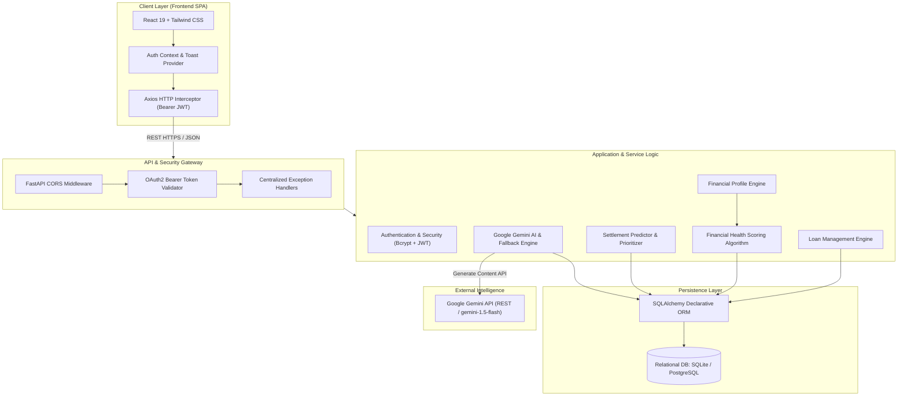

# FinRelief AI — System Design & Architecture Document (HLD & LLD)

**System Version:** 1.0.0  
**Domain:** Fintech, AI-Assisted Debt Recovery & Financial Health Optimization  
**Core Technologies:** FastAPI (Python 3.11+), React 19, Vite, Tailwind CSS, Google Gemini 1.5 Flash, SQLAlchemy, SQLite/PostgreSQL  

---

## 1. Executive Summary & Problem Statement

Millions of individuals fall into compound debt cycles across credit cards, personal loans, vehicle loans, and collateralized debt. Borrowers face three major barriers:
1. **Lack of Clarity:** No unified, explainable metric calculates genuine financial health and recovery trajectory beyond opaque credit bureau scores.
2. **Asymmetric Information:** Borrowers do not know whether a creditor is open to a settlement, what discount percentage is realistic, or how to prioritize multiple debts.
3. **Negotiation Anxiety:** Borrowers lack professional communication tools and legal clarity to draft formal debt settlement offers and counter-offers.

**FinRelief AI** solves this by unifying:
- **Debt Tracking & Portfolio Management**
- **Explainable Financial Health Scoring (0–100 scale)**
- **Empirical Settlement Probability & Priority Engine**
- **Gemini-Powered Generative Negotiation Strategist & Letter Drafter**
- **Graceful Offline Fallback Engine** ensuring 100% operational continuity.

---

## 2. High-Level Architecture (HLD)

The system is designed following a decoupled, layered client-server architecture:



---

## 3. Core Mathematical Models & Algorithms

### 3.1 Financial Health Scoring Algorithm
The Financial Health Score ($S \in [0, 100]$) provides an explainable assessment composed of three core financial pillars:

$$S = \max(0, \min(100, W_{\text{savings}} + W_{\text{dti}} + W_{\text{expense}}))$$

Where:
1. **Savings Rate Component ($W_{\text{savings}} \in [0, 40]$):**
   $$\text{Savings Ratio} = \frac{\text{Monthly Income} - \text{Monthly Expenses}}{\text{Monthly Income}}$$
   $$W_{\text{savings}} = \text{Savings Ratio} \times 40$$

2. **Debt-to-Income (DTI) Component ($W_{\text{dti}} \in [0, 35]$):**
   $$\text{DTI} = \frac{\text{Existing Total Debts}}{\text{Monthly Income} \times 12}$$
   $$W_{\text{dti}} = \max\left(0, 35 \times (1 - \text{DTI})\right)$$

3. **Expense Burden Component ($W_{\text{expense}} \in [0, 25]$):**
   $$\text{Expense Ratio} = \frac{\text{Monthly Expenses}}{\text{Monthly Income}}$$
   $$W_{\text{expense}} = \max\left(0, 25 \times (1 - \text{Expense Ratio})\right)$$

---

### 3.2 Settlement Prediction & Prioritization Engine
Creditor willingness to accept a settlement depends on interest burden, debt age, and the borrower's hardship.

$$\text{Probability} = P_{\text{base}} + \Delta P_{\text{interest}} + \Delta P_{\text{hardship}} + \Delta P_{\text{burden}}$$

- **Base Probability ($P_{\text{base}}$):** $40.0\%$
- **Interest Incentive:** High-interest loans (e.g. credit cards $> 20\%$) have higher charge-off risk; creditors are more receptive:
  $$\Delta P_{\text{interest}} = \min(25.0, (\text{Interest Rate} - 10) \times 1.2)$$
- **Financial Hardship Bonus:** Lower health score indicates impending default, making creditors favor immediate settlements:
  $$\Delta P_{\text{hardship}} = \max\left(0, \frac{60 - \text{Health Score}}{2}\right)$$
- **Debt Burden Incentive:** High DTI indicates distressed recovery capacity:
  $$\Delta P_{\text{burden}} = \min(15.0, \text{DTI} \times 0.2)$$

#### Recommended Settlement Offer ($O_{\text{rec}}$):
$$O_{\text{rec}} = \text{Outstanding Amount} \times \left(0.50 + \frac{\text{Health Score}}{200}\right)$$

#### Negotiation Priority Classification:
- **High Priority:** Outstanding Amount $> \text{₹}100,000$ AND Interest Rate $> 18\%$
- **Medium Priority:** Outstanding Amount $> \text{₹}50,000$ OR Interest Rate $> 12\%$
- **Low Priority:** Secured or lower-rate/balance obligations

---

## 4. Google Gemini AI Engine Architecture

### 4.1 Hybrid AI Pipeline
```
[User Request] 
      │
      ▼
[API Controller] ──> [Assemble Loan, Profile & Score Context]
                              │
                              ▼
                   [Prompt Engineering Engine]
                              │
                    ┌─────────┴─────────┐
                    │                   │
         [GEMINI_API_KEY set?]     [No Key / Error]
                    │                   │
                   YES                  NO
                    ▼                   ▼
       [Google Gemini 1.5 Flash]   [Deterministic Local Fallback]
                    │                   │
                    └─────────┬─────────┘
                              │
                              ▼
                     [Save to AIHistory]
                              │
                              ▼
                  [Return Formatted Response]
```

### 4.2 Prompt Engineering Strategies
1. **Negotiation Strategy:** Tailors tactics, opening bid percentages, psychological framing, objection counters, and tone advice based on the exact loan details and health score.
2. **Settlement Offer Letters:** Formats formal, legally prudent settlement letters adhering to banking protocols with placeholder fields for tracking numbers and dates.
3. **Holistic Advisory:** Analyzes monthly cash flow ratios and issues prioritized repayment steps.

---

## 5. Security & Data Protection Architecture

1. **Authentication:** Stateless JSON Web Tokens (JWT) signed with HMAC-SHA256 (`HS256`).
2. **Password Security:** Salted one-way hashing with `bcrypt` (12 rounds) via Passlib.
3. **Data Isolation & Row-Level Authorization:** Every database query explicitly filters by `current_user.user_id`, preventing horizontal privilege escalation.
4. **Input Validation:** Strict Pydantic models with type checking, numerical constraints, and sanitized strings.
5. **CORS Hardening:** Whitelisted origins for trusted frontend hosts.

---

## 6. End-to-End Sequence Diagram: Settlement Workflow

```mermaid
sequenceDiagram
    autonumber
    actor User as Borrower
    participant FE as React Frontend
    participant API as FastAPI Gateway
    participant DB as SQLite / PostgreSQL
    participant AI as Gemini 1.5 Flash

    User->>FE: Click "Predict Settlement" on Loan
    FE->>API: POST /settlement/predict { loan_id }
    Note over API: Authenticate JWT Token
    API->>DB: Query Loan & FinancialProfile for user_id
    DB-->>API: Return Loan & Profile metrics
    Note over API: Run Scoring & Settlement Algorithm
    API->>DB: Insert into settlement_records
    DB-->>API: Confirmation
    API-->>FE: Return SettlementRecord JSON
    FE-->>User: Display Probability & Recommended Offer

    User->>FE: Click "Draft Settlement Letter"
    FE->>API: POST /ai/letter { loan_id, offer_amount, tone }
    API->>DB: Fetch loan & financial context
    API->>AI: generateContent (contextual prompt)
    AI-->>API: Return generated professional letter
    API->>DB: Save to ai_history
    API-->>FE: Return AI response
    FE-->>User: Render letter with 1-click Copy
```



---

## 7. Scalability & Production Roadmap

1. **Database Migration:** Seamless transition to PostgreSQL on Google Cloud SQL via `DATABASE_URL`.
2. **Caching & Rate Limiting:** Redis-backed rate limiting on AI endpoints and cached financial health score computations.
3. **Containerized Deployment:** Multi-stage Docker builds orchestrating backend and frontend services via Docker Compose or Google Cloud Run.
